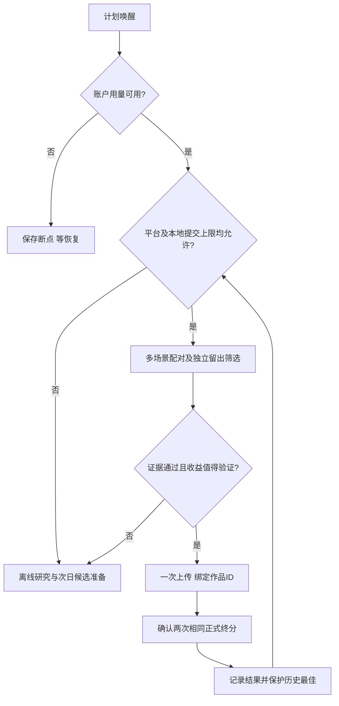

# 自动化：优化、提交与离线研究

[返回首页](../README.md) · [线上CLI](online_judge/README.md) · [MCP与应用工具](mcp/README.md)

第一次拉取仓库，请先读[新用户启动指南](GETTING_STARTED.md)。可以复现离线与评分工具，但个人登录、模型账户和定时任务需要自己配置。

本目录保存可学习、可迁移的流程说明。实际定时任务属于使用者自己的客户端，不把本机调度配置、线程ID、账号或登录会话导出到仓库。

## 三层职责

| 层 | 实现 | 负责什么 |
| --- | --- | --- |
| 决策 | 研究者或智能体 | 分析、设计候选、解释结果 |
| 执行 | Python CLI与本地判题器 | 冻结源码、验证、上传、绑定作品、恢复判分 |
| 调度 | 使用者的任务客户端/MCP工具 | 定时唤醒、账户用量判断和断点续跑 |

克隆仓库不会创建定时任务，离线学习不需要调度层。当前没有独立的MCP server实现。

## 状态机

## 已采用的运行约定

研究目标按[综合得分策略](../docs/daily_research/2026-10-26-total-score.md)：主指标为包含零分的均衡平均分；个别样例退化如实报告，不再一票否决总体收益。选择与偏移留出检查整体零分率和最低四分之一平均分，先固定唯一优胜源码再做独立确认。所有极端反例仍保留。

- 比赛次数按北京时间每天00:00刷新，每日最多30次团队额度；每次提交以平台实际剩余次数为准。
- 当前采用本地优先策略：自动研究每天最多使用3次团队提交额度，可以为0；达到某个分数不改变此上限，不再以用尽次数为目标。
- [研究策略配置](research_policy.json)与[合格候选清单](../data/experiments/qualified_candidates.json)控制自动控制器；至少1000条独立母曲线、修正的V3及以后生成器、场景分组及留出证据，不能把镜像/缩放当独立样本。整体鲁棒性、独立确认或收益稳定性未过关的候选继续留在本地；相同轨迹只取一个代表。
- 每次正式评分后重新判断，小幅或无收益则暂停该方向的相邻参数搜索。人工单次judge.py submit不套用自动研究上限，仍须本人授权。
- Codex账户五小时/周用量与比赛提交次数分开处理；恢复时间以客户端读数为准。
- 无比赛次数但账户可用时继续离线研究、反例分析和候选排序，准备次日任务。
- 定时任务可每小时检查工作状态，但榜单不每小时读取：只读第一页，至少两小时共享缓存，失败也冷却两小时。
- 本地项目任务需要电脑与网络可用，任务客户端保持运行；账号限制期间不能保证唤醒一定可执行。

[明日统一评测计划](../docs/daily_research/2026-10-27-online-plan.md)使用一个主候选和一个有正式结果条件的备选，不能直接遍历qualified_candidates列表。证据检查CLI只读，不替代上传前实时额度核查。

## 断点至少保存什么

候选的父版本、源码路径及哈希、离线验证结果、已上传作品ID、待取成绩、下一实验和当日提交状态。上传结果不确定时先查原作品，不能重新传一次来“确认”。

线上工具的runs目录属于本机状态，已被忽略；适合分享的实验结论写入docs，正式源码保存在data/versions。每日研究记录可放入docs/daily_research，提交前整理并去掉本机私有信息。

## 迁移到自己的环境

1. 先跑通[离线快速开始](../docs/guides/quickstart.md)。
2. 阅读[线上工具](online_judge/README.md)，配置自己的浏览器并验证只读命令。
3. 调整[每日研究提示词](prompts/daily-optimization.md)中的工作区和本人允许的提交范围。
4. 在自己的任务客户端创建定时任务，先观察一次受控运行，再启用持续执行。

历史控制器dev/tools/online_search_loop.py不是通用定时服务；其父版本、队列和停止逻辑需要按当前实验检查，不能直接复用他人的状态文件。

[10月27日刷新恢复记录](../docs/daily_research/2026-10-27-coarse-breakthrough.md)：已投递作品恢复首读即刷新，只有新鲜同作品终分才确认；普通等待沿用600秒，显式短等待退出后用wait原ID恢复。
