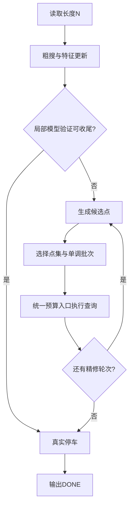

# 按调用关系读懂求解器

[文档导航](../README.md) · [源码](../../main.cpp)

本文对应已记录203239版；[2026-10-26分析](../daily_research/2026-10-26-analysis.md)解释参数的正式证据。它是固定策略的解释，不是对任意输入全局最优的证明。

## 先读统一动作入口

| 函数 | 阅读重点 |
| --- | --- |
| canRead / readReal | 查询额度、移动方向、返回旧冠军的路径预留 |
| sample | 已查询值的缓存；缓存命中不产生物理移动 |
| better / tieBetter | 原始值冠军和中央平局规则 |
| routeSafe / orient | 整批路径是否合法、升序还是降序更便宜 |
| finish | 必要时重新真实查询冠军点，随后DONE |

可以把这些函数理解为所有策略共享的执行层。任何新算子都应通过它们行动。

## 再看探索如何停止

explore从0、4、12、24开始，主要用8格网格右探。features根据不等间距样本计算斜率、残差波动、竞争高值区、局部峰与回升证据。

显著性、竞争区左边界和下降侦察共同限制探索。后半程最佳点使用较短的侦察门槛；全平观测有中央落地和有限前探。粗搜128是上限，不表示每例都用128次。

当前“noise”还受采样间隔和曲率结构影响；24倍门槛是实验参数，不能称为校准过的统计置信度。

## 候选池与模拟退火

pool将最佳点邻域、竞争簇、拟合顶点、危险边缘和大间隔补点放入候选池，使用优先级合并重复点。候选池大小不等于真实查询数。

selectPlan在候选过多时选一个可行子集，内部用模拟场景评估，并进行最多112次退火邻域尝试。它搜索的是“下一批查哪些点”，实际执行仍按单调批次进行。退火计算不向裁判查询。

六个虚拟场景主要来自插值和小扰动。若虚拟场景低估某个未读尖峰，优化器再充分也可能放弃它。这是[后续研究](../下一轮优化分析.md)中的重要问题。

## 局部模型验证与回退

平滑、显著且没有明显竞争峰时，比较三点二次顶点v1与±24邻域的多点拟合顶点v2，要求abs(v1-v2)<10。先将区间向外取整为[floor(min(v1,v2))-3, ceil(max(v1,v2))+3]，并保留预测中心±3，再截断到已探索范围。在该区间逐点读取原始值；原始冠军严格处于窗口内部才可收尾，否则回到常规半径8的精修。

两个模型共享数据和模型族，一致不等于独立确认。局部验证也不是全局证书。半径变化需要同步检查“最佳点位于验证窗口内部”的条件。

## 算子编号怎样读

源码保留12类、96个设计项的触发编号。它们含特征、约束、计划和真实动作，不是96个互相独立的搜索算法。先读执行层和调用关系，再用[算子设计表](../搜索算子与分支策略设计.md)查编号，更容易理解。
