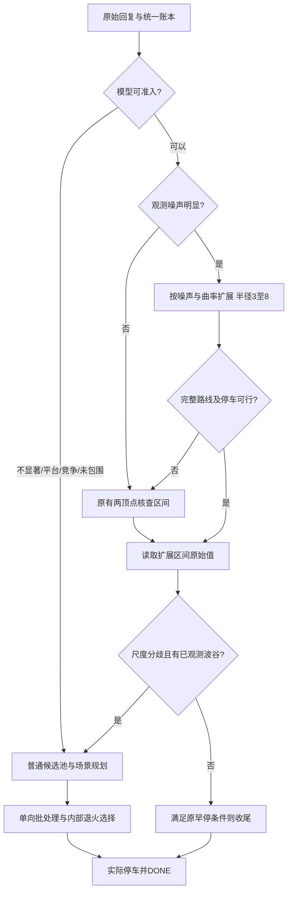

# 2026-10-26：混合难例、算子消融与分支泛化

[文档导航](../README.md) · [上一轮综合得分记录](2026-10-26-total-score.md) · [本轮完整汇总](../../data/experiments/branch_lab_20261026/research_summary.json)

## 针对用户要求的调整

用户要求多样例、多算子、分支处理，并明确不能只测简单曲线来获得漂亮的本地分数。本轮保持包含零分的综合分目标，新增独立的[混合生成器V4](../../dev/tools/mixed_scenarios.py)，保留原V3及全部历史失败。没有按任何求解器得分筛选或丢弃曲线，没有用样例编号、种子、家族标签或真实目标作为C++分支输入。

本轮基准交互26049次，线上上传0次、榜单请求0次。main.cpp仍是最高正式203239源码。所有基准协议、Q≤199、O≤6和已观测最佳原始值停车检查通过；距离、冗余导致的零分照实计入结果。

## 数据怎样变难，怎样防止过拟合

原22族多为单个峰形或单类扰动，新24族交叉组合非对称峰、相关/异方差噪声、肩峰、近等高竞争峰、长平坦前缀、早弱峰/晚强峰、背景漂移、量化饱和、多平台并列、变频纹波及边界竞争。保留无结构随机和单点尖峰两类信息受限诊断，所有零分仍计入综合分。

每例由种子标签、划分、家族和序号的SHA256派生独立随机源，增长样例数不改变同名样例。长度400–1000，包含奇偶边界；幅度、峰位置、宽度和噪声参数独立变化。镜像/偏移/缩放共享母曲线身份，不重复计作独立证据；完全相同数组去重。

预设中等/困难/极端扰动强度比例1:2:1，标签按参数指定，不按求解器成绩挑选。噪声也可能使迟发信号更早可见，因此各强度层的得分不必单调，不能通过删掉“太难”或“反而容易”的案例美化结果。

基础模板随开发/选择/偏移划分改变，包括高斯、指数、三角、Lorentz、分段、紧支撑余弦和超高斯等；部分物理组件共用，不声称所有函数组件完全不重叠。最终确认另加4个未用于候选评分选择的族：模态桥接、背景变点、主峰遮挡、复合纹波。复合纹波主要提供频率/相位分布偏移，不冒充完全全新的物理机制。

[实验协议](../../data/experiments/branch_lab_20261026/protocol.json)与[开发后冻结的入围名单](../../data/experiments/branch_lab_20261026/finalists.json)记录所有种子和范围。

## 四种算子与八个候选

[生成脚本](../../dev/tools/build_branch_candidates.py)从上一轮独立确认源码派生，每个改动精确匹配一次，候选字节与SHA256冻结。

| 算子 | 分类/触发证据 | 动作及预算控制 |
| --- | --- | --- |
| 阶梯精判 | 非递增前缀、足够相同步值、下降幅度相近 | 仅对可信阶梯施加模型前沿限幅；上升出现时解除 |
| 竞争峰核查 | 8–32格内存在接近最高原始值的竞争峰 | 两个峰各补查半径3，最多12点，整段路线先验算 |
| 噪声自适应核查 | 通过模型准入且f.noisy为真 | 根据噪声/局部曲率估计核查范围，半径限制3–8；路线不可行则退回原范围 |
| 平台入口顺路补查 | 高值区至少3个同级观测，跨越至少24格 | 请求入口之后3个未查点，合并进原单向精修路线；不另外来回扫 |

测试四个独立算子、全部叠加、噪声＋竞争峰、噪声/竞争峰互斥树、平台早停守卫，共8个候选。开发集只用于这一次组合调整，此后不看选择和确认结果改源码。

| 开发候选 | 24族均分（含0） | 零分数/384 |
| --- | ---: | ---: |
| 正式203239 | 1399.63 | 152 |
| 上一轮本地版 | 1415.65 | 149 |
| 阶梯精判 | 1409.34 | 150 |
| 竞争峰核查 | 1426.96 | 146 |
| **噪声自适应范围** | **1439.98** | **145** |
| 平台顺路补查 | 1415.61 | 149 |
| 全部叠加 | 1433.30 | 145 |
| 噪声＋竞争峰 | 1439.08 | 144 |
| 噪声/竞争峰互斥树 | 1437.40 | 145 |
| 平台早停守卫 | 1415.86 | 149 |

开发阶段只生成development，表格使用groups.development中的完整均分，不用三划分总体占位值；开发样例不足1000且没有验证划分，资格字段为false是预期。

算子多不代表得分高。噪声自适应单算子优于全叠加；平台模块触发较少，阶梯精判漏掉了原先可挽回的一部分例子。没有为了保留新逻辑而放宽评价。

通过--trace-solvers记录真实分支激活，不只看实现是否存在：首轮519条（含变体与公共验收）中，噪声扩展在141条触发，竞争峰核查在98条触发，精判阶梯限幅在4条触发，平台顺路补查在4条触发。[分支覆盖及难度分层](../../data/experiments/branch_lab_20261026/difficulty_and_coverage.json)单独给出母曲线口径。

## 双域选择，不只追一个本地分布

按开发均分固定噪声范围、噪声＋竞争峰两个入围者，再运行独立种子的混合选择集和未使用的经典样例。经典、混合两域均分各占50%，权重在查看选择结果前指定，不能通过多放简单案例改变排序。

| 选择版本 | 混合均分 | 经典均分 | 等权综合 |
| --- | ---: | ---: | ---: |
| 正式203239 | 1386.59 | 1860.79 | 1623.69 |
| 上一轮本地版 | 1420.13 | 1911.33 | 1665.73 |
| **噪声范围** | **1442.73** | 1918.50 | **1680.61** |
| 噪声＋竞争峰 | 1437.92 | 1918.58 | 1678.25 |

[唯一优胜源码冻结记录](../../data/experiments/branch_lab_20261026/selection_decision.json)在最终确认前落盘。没有根据确认成绩切换候选。

## 独立确认结果

混合确认使用新种子，覆盖28族、1512条母曲线；经典确认使用全新156–173号样例。两域都保留正式源码和上一轮本地源码作对照。

| 确认指标 | 正式203239 | 上一轮本地版 | 本轮候选 |
| --- | ---: | ---: | ---: |
| 混合均分 | 1345.93 | 1391.54 | 1413.14 |
| 混合零分数 | 635 | 601 | 588 |
| 经典均分 | 1855.60 | 1911.63 | 1917.62 |
| 经典零分数 | 245 | 213 | 210 |

混合均分比正式版提高约5.0%，经典提高约3.3%；等权综合提高约4.04%。同一确认集上，相对上一轮本地版，混合增加21.60分/例，经典增加6.00分/例，等权增加13.80分/例。相对上一轮的经典额外提升较小，合并选择/偏移留出差值区间包含0，不宣称这部分已显著提高；主要新增收益来自混合场景。

4个额外留出族的均分从正式版1354.53、上一轮1397.14提高至1442.63。不能因此隐藏失败：其中modal_bridge（分离双峰加缓变桥接）三个版本全部54/54零分。这是明确的整族盲区，完整计入总分并保留[原始曲线与轨迹](../../data/experiments/branch_lab_20261026/counterexamples/modal_bridge_examples.json)。本轮没有在看到此结果后再改候选；后续会将其转入开发研究，并另设新的留出结构。

混合数据零分超过25%，所以CVaR25为0，对尾部改善没有额外区分力，不把“该值没下降”包装成尾部已解决。经典域的尾部及各压力层结果单独记录。[未见族与扰动强度](../../data/experiments/branch_confirm_mixed_20261026/novel_and_difficulty.json) · [混合确认](../../data/experiments/branch_confirm_mixed_20261026/scorecards/champion.json) · [经典确认](../../data/experiments/branch_confirm_classic_20261026/scorecards/champion.json)

## 最终候选的实际分支

最终只保留噪声范围改动，继承已验证的探索、竞争峰池、宽域波谷及路径规划分支；没有把所有实验模块塞进正式入口。



[独立确认候选源码](../../data/experiments/branch_lab_20261026/noise_radius.cpp)摘要为94343cd949f009436aa3b94485a9da5040d75237f6ebbc20190e7f44791e7dd7。只这一份替换合格候选清单，经典与混合两域证据均关联保存；已实际运行上传前证据审核，未上传。main.cpp保持最高正式203239版本，模型真实冗余仍无通用保证。

## 复现与后续

```bash
python dev/tools/build_branch_candidates.py
python dev/tools/screen_operators.py --suite mixed --mixed-seed 20261026403 --novel-families --per-family 18 --out data/experiments/branch_confirm_mixed_20261026 --extra-cases data/experiments/zero_first_20261026/acceptance_cases.json --program formal203239=main.cpp --program previous=data/experiments/robust_total_20261026/flat175_desc.cpp --program champion=data/experiments/branch_lab_20261026/noise_radius.cpp
python dev/tools/screen_operators.py --case-offset 156 --per-family 18 --out data/experiments/branch_confirm_classic_20261026 --extra-cases data/experiments/zero_first_20261026/acceptance_cases.json --program formal203239=main.cpp --program previous=data/experiments/robust_total_20261026/flat175_desc.cpp --program champion=data/experiments/branch_lab_20261026/noise_radius.cpp
python dev/run.py check
```

输入或策略身份改变时使用新输出目录。下一批经典样例从174开始，混合数据使用新的种子标签。现有4个留出族已经消费，不能在针对它们调优后仍称其为全新验证。

下一步优先研究分离模态与缓变背景造成的覆盖盲区；同时保留孤立早峰控制，不能为修复这54例而盲目大跨度跳转、忽略不可逆冗余。所有候选仍按整体得分比较，正式分数只能由线上评测确认。
