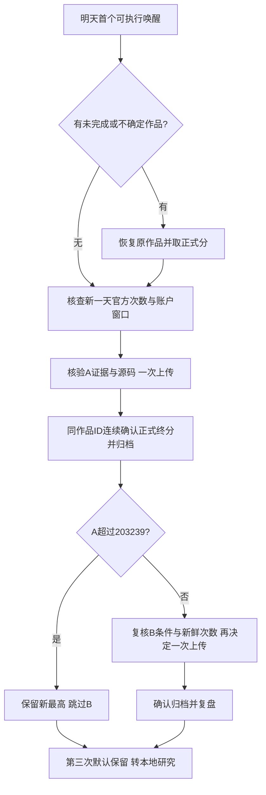

# 2026-10-27线上批次准备与后续优化

准备日期：2026-10-26；计划评测日期：2026-10-27，Asia/Shanghai。

[文档导航](../README.md) · [上一轮混合/多分支确认](2026-10-26-multi-branch.md) · [冻结线上计划](../../data/experiments/nextday_20261027/online_plan.json)

## 先用真实损失确定方向

对已确认主候选A的两份独立本地报告做逐例分解。以知道真实目标后直接查询一次的2999−target作为理想上界，仅用于记账，不表示未知曲线可以达到。

| 统计 | 混合确认 | 经典确认 |
| --- | ---: | ---: |
| 零分导致的损失占理想上界差距 | 82.18% | 60.75% |
| 正分样例精确命中真实目标 | 920/924 | 973/978 |
| 正分损失中的额外移动＋冗余 | 74.90% | 76.70% |
| 正分损失中的停车距离罚分 | 0.38% | 0.29% |

所以不应继续围绕已拿正分的1格误差微调，也不应只增加退火轮数。优先挽回漏峰/冗余零分，其次减少过扫与折返。零分原因可重叠，记账时每条零分只计一次整体损失；正分的查询、运动、转向、冗余、距离分解与原计分逐例核对一致。

[混合损失分析](../../data/experiments/nextday_20261027/mixed_loss_analysis.json) · [经典损失分析](../../data/experiments/nextday_20261027/classic_loss_analysis.json) · [分析工具](../../dev/tools/analyze_search_losses.py)

## 仍值得优化的四个方向

1. **把未探索尾部纳入决策。** 当前虚拟场景先全部填背景值，主要在已观察区间内插值；候选池也拒绝coarse frontier以外的位置。再多退火迭代也不会主动考虑未进入候选池的第二峰。下一轮应在探索阶段比较“继续衰减、弱回升成第二峰、宽平台末端抬升”等假设，并明确计入远探可能使早峰冗余归零的损失；保留孤立早峰控制，禁止跳远后再回退来假装恢复冗余。

2. **按收益而非固定比例使用精修预算。** 当前退火子计划通常至少保留budget的80%，即使边际收益低也不能充分删点。可研究以必要冠军邻域、活跃竞争区代表点和停车组成最小集合，其余查询按预期综合分改善决定是否加入。必须同时改进不确定性场景，不能只砍预算导致隐藏最高点漏查。112次退火是虚拟计划迭代，与实际查询≤199不同。

3. **优化移动结构。** 在现有点增删、微移、覆盖替换之外，加入“整段替换”和“竞争区预算交换”，允许在保持单向路线的条件下重新分配一个小区间的采样密度。比较节省的折返/过扫与新增漏峰，不只比较查询数。先在开发集消融，再用未见混合/经典样例确认。

4. **补充得分成本保护。** 当前Q/O/停车守卫不等于最终得分一定正：已有1条预算和距离等硬条件均满足、但总路径成本将公式分数耗到0的案例。可研究动作加返回当前已知最佳点后的预计得分储备；这仅是以已知最佳为真的模型保护。若当前最佳已处于冗余零分风险，也不能用该保护把救援搜索锁死。

分离双峰桥接族54/54失败仍是重点，但现有确认族已经消费，不会为刷这54例而当天补特判、再复用同一留出声称泛化成功。

## 明天只测有信息价值的候选

### A：已独立确认的主候选

[源码A](../../data/experiments/branch_lab_20261026/noise_radius.cpp)，SHA256前缀94343cd949f0。包括已确认的探索与模型分支，作为第一条线上实验。

### B：单因素保守备选

[源码B](../../data/experiments/nextday_20261027/formal_noise_only.cpp)，SHA256前缀b75dfd86829a。在203239正式版上只增加噪声/曲率自适应核查，不带平坦175、下降前缀限幅和宽域波谷改动。

B在创建后即冻结，再用新混合种子20261026404和经典174–191号样例验证。混合的4个追加族已经在上一轮观察过，因此本轮只称新参数/新种子验证，不再称结构全新。

| 新验证集均分（含0） | 正式203239 | 主候选A | 备选B |
| --- | ---: | ---: | ---: |
| 混合 | 1392.14 | 1473.30 | 1439.65 |
| 经典 | 1871.14 | 1933.91 | 1875.55 |

两者都通过现行本地检查，A仍明显领先。B“保守”仅指改动范围小，并不是已经证明风险更低。B的意义是A如果不适应线上分布，可以测试单一改动是否更容易迁移；总分对照仍不能定位到某条官方曲线或某个具体有害分支。

本轮额外9828次真实交互，未上传，未访问榜单。新结果不预测明天正式分数。

## 串行评测树



实际执行还要检查父版本是否仍匹配当前最高正式源码。若其他实验已改变最高版，则重新评估，不机械提交过期计划。A若结果不确定或尚未归档，B必须继续等待。新代码已把B的日期和正式主候选结果条件接入资格检查，未见A的正式记录时会拒绝B；A提分则B也被阻止。没有让本地分数触发B。

默认每天自动研究最多使用3次团队提交，是上限；本批通常只需1次，A未提升且B条件满足时才第2次。第三次没有预排实验。不会重复上传已评分的203239基线或把全部8个离线变体送线上。

## 执行命令与记录

以下只是条件满足后的单次命令，不是无条件批处理：

```bash
# 只读证据检查，不查实时额度、不上传
python dev/tools/research_policy.py data/experiments/branch_lab_20261026/noise_radius.cpp
python dev/tools/research_policy.py data/experiments/nextday_20261027/formal_noise_only.cpp

# A优先；上传前另核查官方实时额度
python automation/judge.py submit --file data/experiments/branch_lab_20261026/noise_radius.cpp

# 仅A正式未提升且B条件满足时
python automation/judge.py submit --file data/experiments/nextday_20261027/formal_noise_only.cpp

# 按作品确认后记录，会保留实际父版本、参数和最高正式源码
python dev/tools/policy_search.py record WORK_JOB_ID --name TRIAL_NAME
```

当前只读实测：A证据通过；B按预期被“主候选尚无正式结果”阻止。队列、源码、完整摘要和回退规则均已落盘。电脑、网络、登录和客户端需要可用；账户窗口不足则保留断点，恢复后再查当日真实次数，不把五小时窗口与平台午夜刷新混为一谈。

## 10月27日实际执行：平台内部错误

A于北京时间00:02:11上传一次，平台返回`internal_error`及`-1`占位值；没有可用的正式算法分数。实时核查当日已用1次、剩余29次。此次不纳入正式得分归档，也不视作A未超过203239来解锁B。

已修复API/DOM对该明确错误枚举的识别，137项线上工具离线测试通过。保留失败作品和原始源码，不自动重复上传；B继续等待有效的A正式成绩。main.cpp保持203239最高正式版。执行详情见[错误记录](../../data/experiments/nextday_20261027/platform_error.json)。
